# 🍽️ NOIR – Food Delivery Mobile App UI Kit

Bộ giao diện **ứng dụng đặt đồ ăn cao cấp** trên điện thoại, gồm **10 màn hình** dạng vector chỉnh sửa được. Phong cách tối giản, sang trọng với tông đen, vàng đồng và kem.

> 📱 Kích thước màn hình: **390 × 844** (iPhone 14/15) · 🖋️ Định dạng: **SVG**

---

## 📁 Cấu trúc repo

```
├── design/
│   ├── noir_food_delivery_ui.svg   # File thiết kế gốc (vector)
│   └── screens/
│       ├── noir-ui-kit.png         # Ảnh tổng hợp cả 10 màn hình
│       ├── 01-splash.png
│       ├── 02-onboarding.png
│       ├── ...
│       └── 10-profile.png
└── README.md
```

### Cách chỉnh sửa file SVG
- **Figma:** kéo thả file `.svg` vào canvas. Các lớp (chữ, hình, nút) vẫn tách riêng nên sửa được.
- Hoặc mở bằng **Adobe Illustrator**, **Inkscape** hoặc trình duyệt để xem.

---

## 📸 Toàn bộ giao diện

<p align="center">
  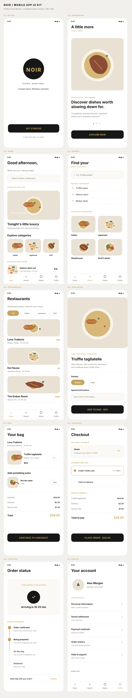
</p>

---

## 🖥️ Các màn hình

### Bắt đầu
| 01 · Splash | 02 · Onboarding |
|:---:|:---:|
| 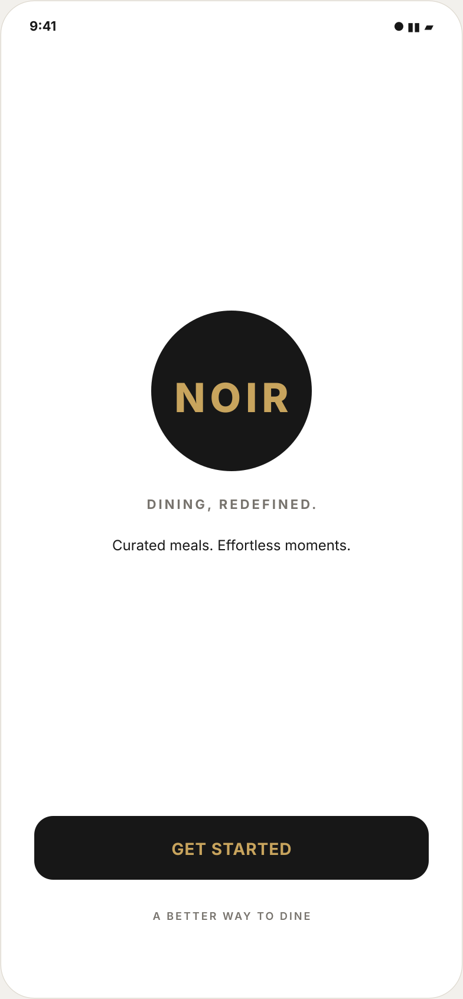 | 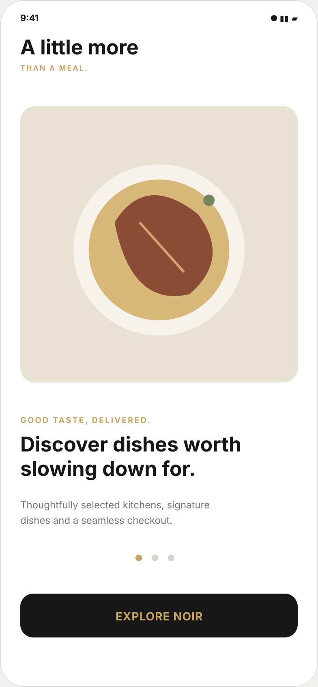 |
| Logo NOIR, slogan *"Dining, redefined."*, nút **Get Started** | Giới thiệu app, chấm chỉ trang, nút **Explore Noir** |

### Khám phá
| 03 · Home | 04 · Search | 05 · Restaurants |
|:---:|:---:|:---:|
| 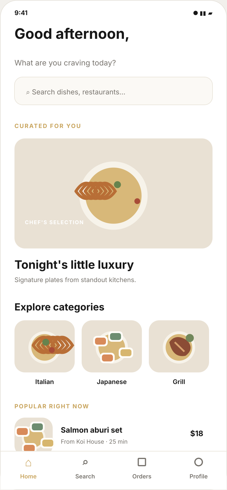 | 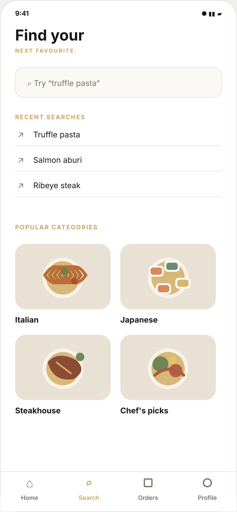 | 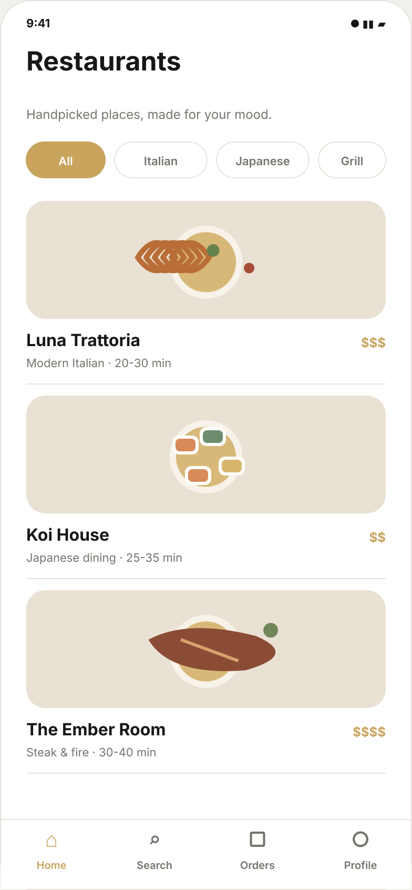 |
| Lời chào, ô tìm kiếm, món gợi ý của đầu bếp, danh mục, món phổ biến | Tìm kiếm gần đây, danh mục phổ biến dạng lưới | Lọc theo loại ẩm thực, danh sách nhà hàng kèm thời gian giao và mức giá |

### Đặt món
| 06 · Dish Detail | 07 · Bag | 08 · Checkout |
|:---:|:---:|:---:|
| 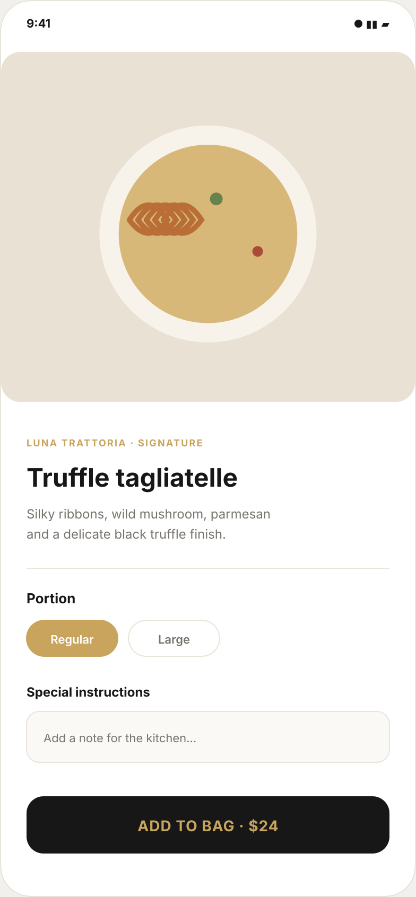 | 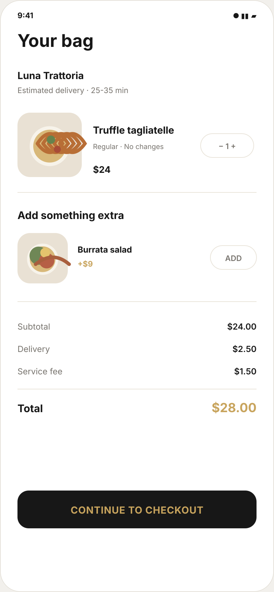 | 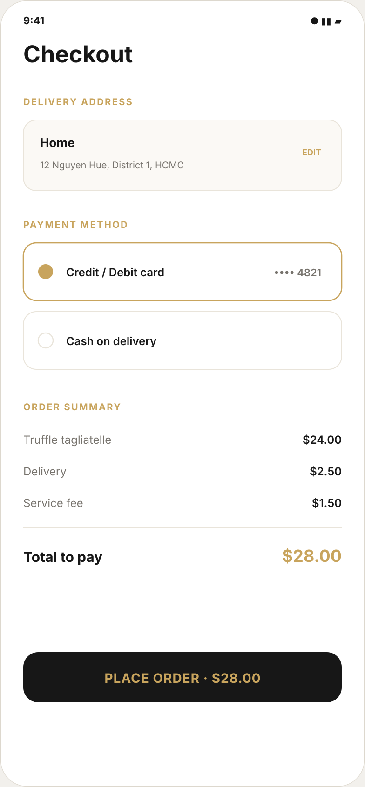 |
| Ảnh món, mô tả, chọn khẩu phần, ghi chú cho bếp, nút **Add to Bag** | Giỏ hàng, tăng/giảm số lượng, gợi ý món thêm, tạm tính | Địa chỉ giao, phương thức thanh toán (thẻ / tiền mặt), tổng tiền, **Place Order** |

### Sau khi đặt
| 09 · Tracking | 10 · Profile |
|:---:|:---:|
| 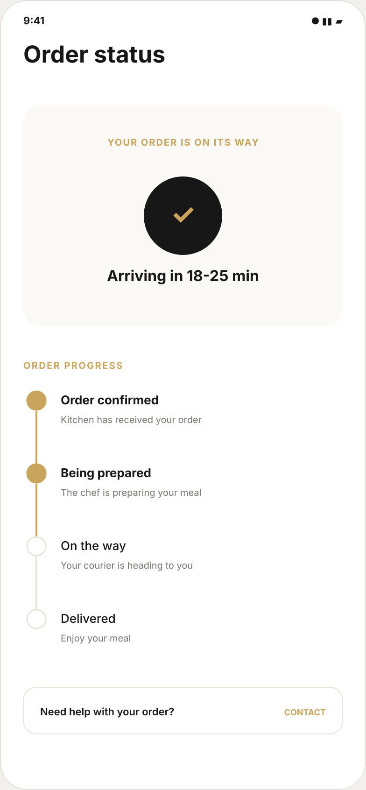 | 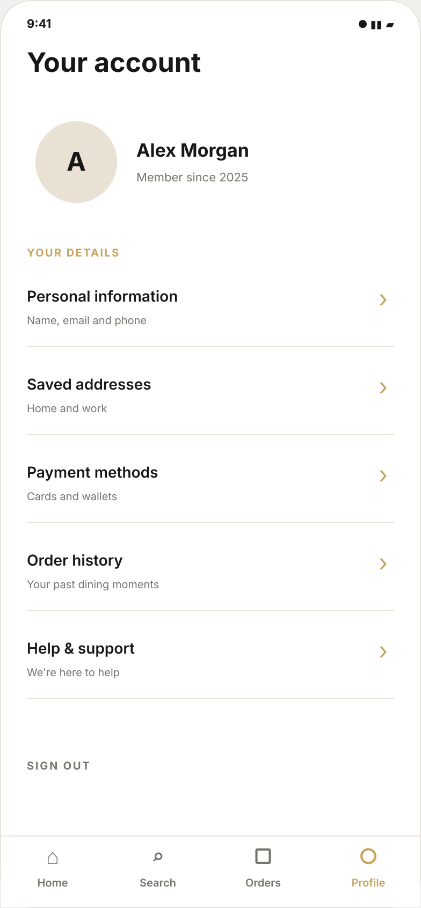 |
| Thời gian giao dự kiến, tiến trình 4 bước (xác nhận → chuẩn bị → đang giao → đã giao), liên hệ hỗ trợ | Thông tin tài khoản, địa chỉ đã lưu, phương thức thanh toán, lịch sử đơn, hỗ trợ, đăng xuất |

---

## 🔄 Luồng người dùng

```
Splash → Onboarding → Home ─┬─→ Search ──────┐
                            └─→ Restaurants ─┴─→ Dish Detail → Bag → Checkout → Tracking
                                                                         Profile (tab bar)
```

Thanh điều hướng dưới (tab bar) gồm 4 mục: **Home · Search · Orders · Profile**.

---

## 🎨 Style guide

### Màu sắc
| Màu | Mã | Dùng cho |
|---|---|---|
| ⬛ Đen than | `#171717` | Tiêu đề, nút chính, logo |
| 🟫 Xám ấm | `#77736D` | Chữ phụ, mô tả |
| 🟨 Vàng đồng | `#C8A45D` | Nhãn, giá tiền, trạng thái đang chọn |
| 🟨 Vàng nhạt | `#D8B879` | Điểm nhấn phụ |
| ⬜ Kem | `#F7F3EA` / `#E9E1D4` | Nền thẻ, nền ảnh minh họa |
| ⬜ Nền | `#F2F0EC` | Nền tổng |

### Typography
- **Font:** Inter (dự phòng: Arial, sans-serif)
- **Tiêu đề:** Inter ExtraBold, chữ in hoa giãn khoảng (letter-spacing) cho nhãn mục
- **Nội dung:** Inter Regular, cỡ 11–14px

### Thành phần
- Nút chính: nền đen, chữ vàng đồng, bo góc lớn
- Chip lọc: bo tròn, trạng thái chọn có nền vàng đồng
- Thẻ: bo góc mềm, nền kem, viền mảnh `#DDD8CE`
- Khung điện thoại: bo góc 28px

---

## 📌 Ghi chú

- Tên nhà hàng, món ăn, giá và thông tin người dùng trong thiết kế chỉ là **dữ liệu mẫu**.
- Ảnh PNG trong `design/screens/` được xuất từ file SVG ở độ phân giải 2x.
